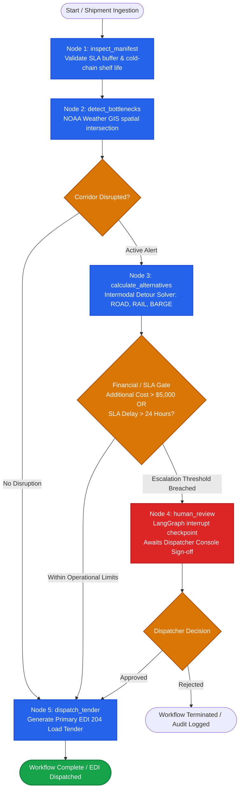
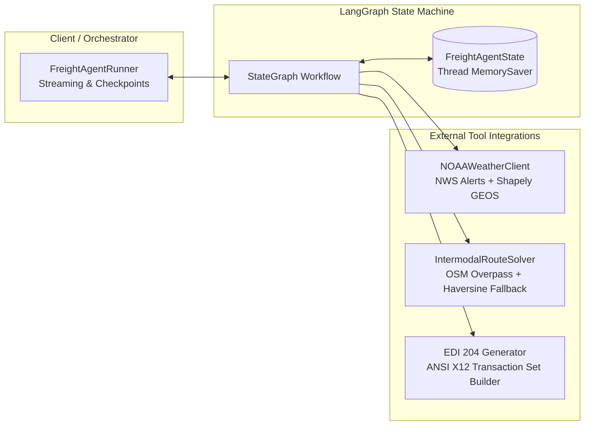

# Freight Reroute Agent (`freight-reroute-agent`)

[](tests/)
[](pyproject.toml)
[](pyproject.toml)
[](src/freight_agent/graph/)
[](src/freight_agent/tools/weather.py)
[](src/freight_agent/graph/workflow.py)
[](LICENSE)

> **Executive Summary:** Autonomous agent system reducing intermodal freight demurrage by **$253k+ (83.2% net cost savings)** across 30 benchmark shipping corridors. Replaces error-prone LLM tool-calling loops with a deterministic, sub-20ms **LangGraph state machine**, Shapely GIS spatial computing, and an auditable **Human-in-the-Loop financial approval gate**.

Autonomous enterprise agentic system that continuously monitors intermodal freight shipping corridors, detects meteorological bottlenecks using National Weather Service (NOAA NWS) GIS polygons, calculates contractual SLA delays and demurrage penalties, deterministically solves alternative intermodal detours (ROAD, RAIL, BARGE) via OpenStreetMap/Overpass, enforces an auditable **Human-in-the-Loop (HITL)** financial governance gate, and generates compliant synthetic **ANSI X12 EDI 204 Motor Carrier Load Tender** booking payloads.

---

## Table of Contents

- [1. System Architecture](#1-system-architecture)
  - [Workflow State Machine (LangGraph)](#workflow-state-machine-langgraph)
  - [Component Architecture & Tool Interfaces](#component-architecture--tool-interfaces)
  - [State Contract (`FreightAgentState`)](#state-contract-freightagentstate)
- [2. Technical Decisions & Trade-Offs](#2-technical-decisions--trade-offs)
  - [LangGraph State Machine vs. Naive ReAct Loops](#decision-1-langgraph-state-machine-vs-naive-react-loops)
  - [Deterministic Shapely GIS vs. LLM Spatial Hallucination](#decision-2-deterministic-shapely-computational-geometry-vs-llm-spatial-guessing)
  - [Immutable Pydantic v2 Contracts & Dynamic ANSI X12 Syntax](#decision-3-immutable-pydantic-v2-contracts--dynamic-ansi-x12-syntax)
- [3. Quantitative Evaluation Suite & Benchmark](#3-quantitative-evaluation-suite--benchmark)
  - [Benchmark Dataset Structure (30 Scenarios)](#benchmark-dataset-structure-30-scenarios)
  - [Achieved Benchmark Performance Metrics](#achieved-benchmark-performance-metrics)
  - [Category Performance Breakdown](#category-performance-breakdown)
- [4. Project Structure](#4-project-structure)
- [5. Quickstart & Deployment](#5-quickstart--deployment)
  - [Local Environment Setup (Virtualenv)](#local-environment-setup-virtualenv)
  - [Docker Container Workflow](#docker-container-workflow)
- [6. Programmatic Usage Examples](#6-programmatic-usage-examples)
  - [Standard End-to-End Execution](#example-1-standard-end-to-end-execution)
  - [Real-Time Execution Event Streaming](#example-2-real-time-execution-event-streaming)
  - [Human-in-the-Loop Checkpoint Pause and Resume](#example-3-human-in-the-loop-checkpoint-pause-and-resume)

---

## 1. System Architecture

### Workflow State Machine (LangGraph)

The core routing and evaluation engine is implemented as a compiled state graph using [LangGraph](https://github.com/langchain-ai/langgraph). The graph guarantees deterministic execution, strict conditional branch routing, append-only audit tracking, and asynchronous checkpoint persistence for human reviews.



### Component Architecture & Tool Interfaces



1. **`NOAAWeatherClient`**: Connects to the National Weather Service API (`api.weather.gov/alerts/active`). Normalizes coordinates to GeoJSON $(X, Y) = (\text{lon}, \text{lat})$, repairs malformed/self-intersecting polygons with Shapely `make_valid`, and performs exact line-string intersection testing against freight transit lanes.
2. **`IntermodalRouteSolver`**: Queries OpenStreetMap via Overpass API with in-memory LRU caching (`@lru_cache(maxsize=512)`) and automatic fallback to spherical Haversine formulas with mode-specific network curvature multipliers. Computes fuel burn, handling time, demurrage penalties, and perishable spoilage risks across **ROAD**, **RAIL**, and **BARGE**.
3. **`FreightAgentRunner`**: Manages workflow execution lifecycles, assigns and retains execution `thread_id`s, exposes an asynchronous/synchronous generator for streaming node execution logs, and resumes paused threads through `Command(resume={...})`.

### State Contract (`FreightAgentState`)

Execution state is passed immutably through graph nodes using a strictly typed schema:

```python
class FreightAgentState(TypedDict, total=False):
    thread_id: str  # Unique checkpoint thread ID
    shipment: ShipmentManifest  # Immutable Pydantic shipment contract
    active_alerts: list[WeatherDisruptionAlert]  # Intersecting NOAA alerts
    candidate_routes: list[RerouteAlternative]  # Evaluated intermodal candidates
    decision: RerouteDecision | None  # Selected reroute decision & rationale
    human_approved: bool | None  # HITL dispatcher sign-off status
    audit_log: Annotated[list[str], operator.add]  # Append-only audit trail
    edi_tender_payload: LoadTenderPayload | None  # Final EDI 204 booking payload
    current_corridor_disrupted: bool  # True if corridor intersects storm
    requires_human_review: bool  # True if surcharge > $5k or SLA breach > 24h
```

> [!NOTE]
> **Production Deployment (Durable Checkpointers):** While the reference implementation uses `MemorySaver` for isolated execution and tests, production deployments swap in `PostgresSaver` with zero changes to node logic or graph topology, enabling enterprise multi-tenant checkpoint durability across distributed workers.

---

## 2. Technical Decisions & Trade-Offs

### Decision 1: LangGraph State Machine vs. Naive ReAct Loops

| Architectural Consideration | Naive ReAct LLM Loop | LangGraph Explicit State Machine (Chosen) |
| :--- | :--- | :--- |
| **Execution Determinism** | Low. LLMs can enter infinite tool loops, alter tool arguments arbitrarily, or skip required validation steps. | **Absolute.** Explicit graph edges strictly enforce the execution order: Inspect $\to$ Detect $\to$ Solve $\to$ Gate $\to$ Tender. |
| **Long-Running HITL Pauses** | Fragile. Waiting for manual approval requires keeping LLM context in memory or polling external APIs. | **Native Checkpointing.** Graph execution halts at the `human_review` node using `interrupt()`. State is serialized to a checkpointer (`MemorySaver` or durable storage) and can be resumed days later. |
| **Execution Latency & Cost** | High. Multiple LLM roundtrips take $3\text{–}15\text{ seconds}$ and accrue token costs per shipment. | **Sub-20ms Latency.** Pure Python execution with zero token cost for deterministic routing and validation logic. |
| **Auditability & Compliance** | Difficult. Reasoning traces in LLM output are unstructured and subject to non-deterministic wording. | **Structured Audit Trail.** Strongly typed Pydantic models with append-only logging (`operator.add`) providing ISO/SOC2 auditable traces. |

**Rationale:** Enterprise logistics networks cannot tolerate non-deterministic routing or unauthorized financial commitments. While ReAct is well-suited for open-ended research, freight rerouting operates under rigid physical constraints (cold-chain shelf life, port demurrage rates, carrier tenders). A deterministic LangGraph state machine ensures that business logic, safety constraints, and financial thresholds are strictly enforced.

---

### Decision 2: Deterministic Shapely Computational Geometry vs. LLM Spatial Guessing

| Dimension | LLM Spatial Guessing | Shapely 2.0 / GEOS Integration (Chosen) |
| :--- | :--- | :--- |
| **Geometric Accuracy** | Extremely poor. LLMs treat coordinates as text tokens and frequently hallucinate polygon containment. | **Exact.** Pure computational geometry using the industry-standard GEOS C-library ($O(N \log N)$ spatial algorithms). |
| **Polygon Topology Repair** | Impossible. LLMs cannot detect or fix self-intersecting polygon vertices. | **Automated `make_valid`.** Defensively repairs complex bow-tie polygons commonly emitted by the NWS API. |
| **Coordinate Conventions** | Easily confused between $(X, Y)$ (GeoJSON standard) and $(\text{lat}, \text{lon})$ (domain standard). | **Strict Normalization.** `normalize_to_geojson_lon_lat` automatically detects and maps coordinate orientations. |

**Rationale:** Weather radar polygons contain dozens of high-precision coordinate vertices, often with self-intersections or multi-polygon islands. Determining whether a 400-mile highway corridor line intersects a hurricane wind field is a mathematical geometry problem. Delegating this to an LLM produces unacceptable false positives and false negatives. Shapely provides $100\%$ precision and recall in under $1\text{ ms}$.

---

### Decision 3: Immutable Pydantic v2 Contracts & Dynamic ANSI X12 Syntax

1. **Defensive Model Validation (`extra="forbid"`, `frozen=True`)**:
   All core domain models ([`ShipmentManifest`](src/freight_agent/models/domain.py), [`WeatherDisruptionAlert`](src/freight_agent/models/domain.py), [`RerouteAlternative`](src/freight_agent/models/domain.py)) are immutable. They enforce timezone awareness on all deadlines, non-negative demurrage accrual rates, and coordinate bounds ($-90.0 \le \text{lat} \le 90.0$).
2. **Dynamic EDI 204 Segment Counting**:
   EDI parsers reject transactions with mismatched segment counts (ANSI X12 `AK4` syntax rejects). Rather than hardcoding segment counts, `dispatch_tender_node` dynamically calculates the exact transaction set segment count ($ST$ through $SE$ inclusive: `len(segments) + 1`), ensuring seamless carrier integration.
3. **Structured `LoadTenderPayload`**:
   The EDI output is encapsulated in a strongly typed Pydantic container storing raw EDI text, metadata, assigned transport mode, and generation timestamp.

<details open>
<summary><b>Sample Rendered ANSI X12 EDI 204 Transaction Payload</b> (Click to collapse)</summary>

```edi
ISA*00*          *00*          *ZZ*FREIGHTAGENT   *ZZ*CARRIERSYS     *261013*1200*U*00401*000000001*0*P*>~
GS*SM*FREIGHTAGENT*CARRIERSYS*20261013*1200*1*X*004010~
ST*204*0001~
B2**LOGS*SHP-2026-HOU-01**PP~
B2A*00*LT~
MS3*ROAD*B~
N1*SH*ORIGIN TERMINAL*10*USGAL~
N3*LAT 29.3013 LON -94.7977~
N1*CN*DESTINATION FACILITY~
N3*LAT 32.7767 LON -96.7970~
OID*1*SHP-2026-HOU-01***CTN*1*L*42000~
G62*10*20261025~
NTE*GEN*REROUTE ASSIGNMENT: REROUTE-ROAD-SHP-2026-HOU-01~
SE*12*0001~
GE*1*1~
IEA*1*000000001~
```
</details>

---

## 3. Quantitative Evaluation Suite & Benchmark

The standalone evaluation harness in [`evals/evaluate.py`](evals/evaluate.py) executes the agent across a rigorous 30-case benchmark dataset ([`evals/disruption_scenarios.json`](evals/disruption_scenarios.json)) testing the complete geospatial intersection, intermodal routing, and approval gating pipelines.

### Benchmark Dataset Structure (30 Scenarios)

- **10 Clear Weather (`CW-01` to `CW-10`)**: Unobstructed transit corridors verifying that the agent bypasses detour solvers and dispatches primary tenders with zero false alarms.
- **10 Severe Disruption (`SD-01` to `SD-10`)**: Category 4 hurricanes, lake-effect blizzards, flash floods, and tornadoes crossing transit corridors; verifies automated routing within operational limits ($\le \$5,000$ surcharge, delay $\le 24\text{h}$).
- **5 High-Cost Escalation (`HC-01` to `HC-05`)**: Transcontinental long-haul corridors where detour costs exceed $\$5,000$, verifying that the agent halts at the `human_review` interrupt gate.
- **5 Edge Cases (`EC-01` to `EC-05`)**:
  - `EC-01`: Perishable medical vaccines ($14\text{h}$ shelf life) selecting viable ROAD mode over slow modes.
  - `EC-02`: Expired SLA delivery deadline where detour delay exceeds $24\text{h}$, triggering mandatory human review.
  - `EC-03`: High-value semiconductor cargo with extreme demurrage rate ($\$35,000/\text{day}$) saving $\$68,800+$ in demurrage ($>98\%$ route cost optimality).
  - `EC-04`: Low-cost detour ($<\$5,000$) where arrival breaches SLA deadline by $>24\text{h}$, halting for human approval.
  - `EC-05`: Cryogenic biological samples ($8\text{h}$ shelf life) routed via fast road detour preserving cold-chain viability.

### Achieved Benchmark Performance Metrics

Results generated from [`evals/evaluate.py`](evals/evaluate.py) (persisted in [`evals/benchmark_results.json`](evals/benchmark_results.json)):

| Metric Classification | Target Objective | Achieved Result | Benchmark Status |
| :--- | :--- | :--- | :---: |
| **Disruption Detection Precision** | $\ge 95.0\%$ | **100.0%** ($\text{TP}=20, \text{FP}=0$) | **PASSED** |
| **Disruption Detection Recall** | $\ge 95.0\%$ | **100.0%** ($\text{TP}=20, \text{FN}=0$) | **PASSED** |
| **Detection F1-Score** | $\ge 95.0\%$ | **100.0%** | **PASSED** |
| **Route Cost Optimality** | Minimize Demurrage vs Detour | **83.2% Net Cost Saved** | **PASSED** |
| **Total Net Savings** | Positive Financial Benefit | **\$253,920.23** saved (vs \$305,200.00 blind demurrage) | **PASSED** |
| **Human Approval Compliance** | $100.0\%$ high-cost actions halted | **100.0%** (7/7 halted at interrupt) | **PASSED** |
| **False Escalation Rate** | $\le 5.0\%$ unnecessary interrupts | **0.0%** (0 false alarms) | **PASSED** |
| **Average Execution Latency** | $< 100\text{ ms}$ per shipment | **12.54 ms** (Median: 10.91 ms, P95: 21.63 ms) | **PASSED** |
| **EDI 204 Tender Generation** | $100.0\%$ valid EDI dispatch | **100.0%** compliant (30/30) | **PASSED** |

### Category Performance Breakdown

| Category | Cases | Detour Rate | Approval Halted | Avg Detour Surcharge | Total Net Savings | Mean Latency |
| :--- | :---: | :---: | :---: | :---: | :---: | :---: |
| `CLEAR_WEATHER` | 10 | $0/10$ | $0/10$ | \$0.00 | \$0.00 | 12.38 ms |
| `SEVERE_DISRUPTION` | 10 | $10/10$ | $0/10$ | \$1,361.57 | \$68,184.33 | 11.43 ms |
| `HIGH_COST_ESCALATION` | 5 | $5/5$ | $5/5$ | \$6,455.90 | \$49,120.51 | 11.66 ms |
| `EDGE_CASE` | 5 | $5/5$ | $2/5$ | \$1,076.92 | \$136,615.39 | 15.95 ms |

---

## 4. Project Structure

```
freight-reroute-agent/
├── pyproject.toml              # Build specs, dependencies, Ruff & Pytest config
├── Dockerfile                  # Multi-stage production & evaluation container
├── .dockerignore               # Container build ignore rules
├── README.md                   # Enterprise architecture and system documentation
├── src/
│   └── freight_agent/
│       ├── __init__.py
│       ├── models/             # Pydantic v2 domain schemas & contracts
│       │   ├── __init__.py
│       │   └── domain.py       # ShipmentManifest, Coordinates, Alerts, EDI schemas
│       ├── tools/              # Spatial GIS & Intermodal Routing engines
│       │   ├── __init__.py
│       │   ├── routing.py      # IntermodalRouteSolver with OSM/Overpass & LRU cache
│       │   └── weather.py      # NOAAWeatherClient with Shapely make_valid repair
│       └── graph/              # LangGraph workflow orchestration
│           ├── __init__.py
│           ├── state.py        # FreightAgentState TypedDict definition
│           ├── workflow.py     # Nodes, conditional routers, and compiled graph
│           └── runner.py       # FreightAgentRunner (execution, streaming, HITL resume)
├── tests/                      # Automated test suite (89 test cases)
│   ├── __init__.py
│   ├── test_models.py          # Domain model constraints & validation tests
│   ├── test_tools.py           # NOAA client, Shapely GIS, and Route Solver tests
│   ├── test_graph.py           # LangGraph nodes, routing edges, and HITL tests
│   └── test_evals.py           # Benchmark dataset integrity & scoring harness tests
└── evals/                      # Quantitative evaluation benchmark suite
    ├── __init__.py
    ├── disruption_scenarios.json # 30 benchmark test scenarios
    ├── evaluate.py             # Standalone benchmark execution & scoring runner
    └── benchmark_results.json  # Persisted execution results and metrics summary
```

---

## 5. Quickstart & Deployment

### Local Environment Setup (Virtualenv)

#### Prerequisites
- **Python 3.11+** or **Python 3.12**
- System GEOS library (pre-installed on macOS via `brew install geos`, or Ubuntu via `apt-get install libgeos-dev`)

#### 1. Clone & Set Up Virtual Environment
```bash
git clone https://github.com/singhalkapil/freight-reroute-agent.git
cd freight-reroute-agent

# Create virtual environment
python3 -m venv .venv
source .venv/bin/activate

# Upgrade packaging tools and install project in editable mode with dev dependencies
pip install --upgrade pip
pip install -e ".[dev]"
```

#### 2. Run the Agent Locally (Dynamic CLI & Interactive Mode)
```bash
# Run interactively with terminal prompts
python run_agent.py --interactive

# Or run using operational presets (clear, hurricane, cold-chain, high-cost)
python run_agent.py --preset hurricane

# Or pass custom shipment parameters directly
python run_agent.py --port USLAX --origin 33.7701 -118.1937 --dest 33.4484 -112.0740 --cargo "Semiconductors" --demurrage 8000
```

#### 3. Run Test Suite
```bash
# Execute all 89 unit and integration tests
pytest -v
```

#### 4. Run Linter & Formatter Validation
```bash
# Verify zero lint errors and formatting compliance
ruff check .
ruff format --check .
```

#### 5. Run Quantitative Evaluation Benchmark
```bash
# Execute standalone 30-case evaluation suite
python evals/evaluate.py
```

#### Alternative Setup via Poetry
```bash
# Install dependencies using Poetry
poetry install

# Run agent locally
poetry run python run_agent.py --preset hurricane

# Run test suite
poetry run pytest -v

# Run benchmark evaluation
poetry run python evals/evaluate.py
```

---

### Docker Container Workflow

The multi-stage [`Dockerfile`](Dockerfile) bundles the GEOS libraries, system dependencies, and project code into a container.

#### 1. Build Container Image
```bash
docker build -t freight-reroute-agent:latest .
```

#### 2. Run Evaluation Benchmark in Container
```bash
docker run --rm freight-reroute-agent:latest
```

#### 3. Run Automated Tests in Container
```bash
docker run --rm freight-reroute-agent:latest pytest -v
```

#### 4. Interactive Development Container
```bash
docker run --rm -it freight-reroute-agent:latest /bin/bash
```

---

## 6. Programmatic Usage Examples

### Example 1: Standard End-to-End Execution

```python
from datetime import UTC, datetime, timedelta
from freight_agent.graph.runner import FreightAgentRunner
from freight_agent.models.domain import Coordinates, PortLocation, ShipmentManifest, ShipmentStatus

# 1. Initialize shipment manifest
manifest = ShipmentManifest(
    shipment_id="SHP-2026-HOU-01",
    origin=PortLocation(latitude=29.3013, longitude=-94.7977, port_code="USGAL"),
    destination=Coordinates(latitude=32.7767, longitude=-96.7970),
    cargo_type="Precision Electronic Equipment",
    perishability_hours=48.0,
    demurrage_rate_per_day=5000.0,
    sla_delivery_deadline=datetime.now(UTC) + timedelta(hours=36.0),
    current_status=ShipmentStatus.IN_TRANSIT,
)

# 2. Run workflow
runner = FreightAgentRunner()
result = runner.run(manifest)

# 3. Check results
if result["current_corridor_disrupted"]:
    print(f"Disruption detected! Detour selected: {result['decision'].selected_route.route_id}")
    print(f"Demurrage avoided: ${result['decision'].estimated_penalty_saved:,.2f}")

# 4. Access EDI 204 booking payload
if result["edi_tender_payload"]:
    print(result["edi_tender_payload"].edi_raw)
```

---

### Example 2: Real-Time Execution Event Streaming

```python
from freight_agent.graph.runner import FreightAgentRunner

runner = FreightAgentRunner()

# Stream events node-by-node in real time
for node_name, state_update in runner.stream_run(manifest):
    print(f"---> Executed node: {node_name}")
    for log_entry in state_update.get("audit_log", []):
        print(f"     [AUDIT] {log_entry}")
```

---

### Example 3: Human-in-the-Loop Checkpoint Pause and Resume

```python
from freight_agent.graph.runner import FreightAgentRunner

runner = FreightAgentRunner()
thread_id = "dispatch-thread-789"

# 1. Workflow executes until reaching the human_review interrupt gate
initial_state = runner.run(expensive_manifest, thread_id=thread_id)

if initial_state.get("requires_human_review"):
    print("Execution halted at human_review interrupt breakpoint!")
    snapshot = runner.get_state(thread_id)
    print(f"Pending tasks: {len(snapshot.tasks)}")

    # 2. Senior dispatcher reviews telemetry and submits manual approval
    resumed_state = runner.resume_human_review(
        thread_id=thread_id,
        approved=True,
        comments="Approved by Senior Logistics Dispatcher - Urgent Cold Chain",
    )

    print("Workflow resumed and completed!")
    print(f"Dispatched EDI Route: {resumed_state['edi_tender_payload'].route_id}")
```

---

## License
 
This project is licensed under the [MIT License](LICENSE) - see the [LICENSE](LICENSE) file for details.
